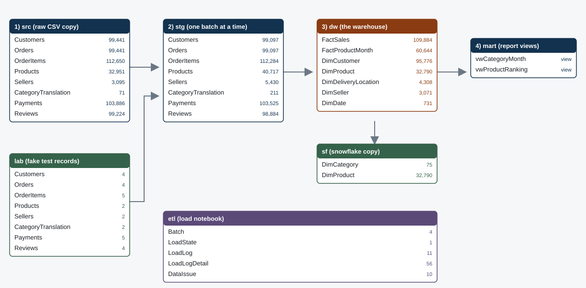
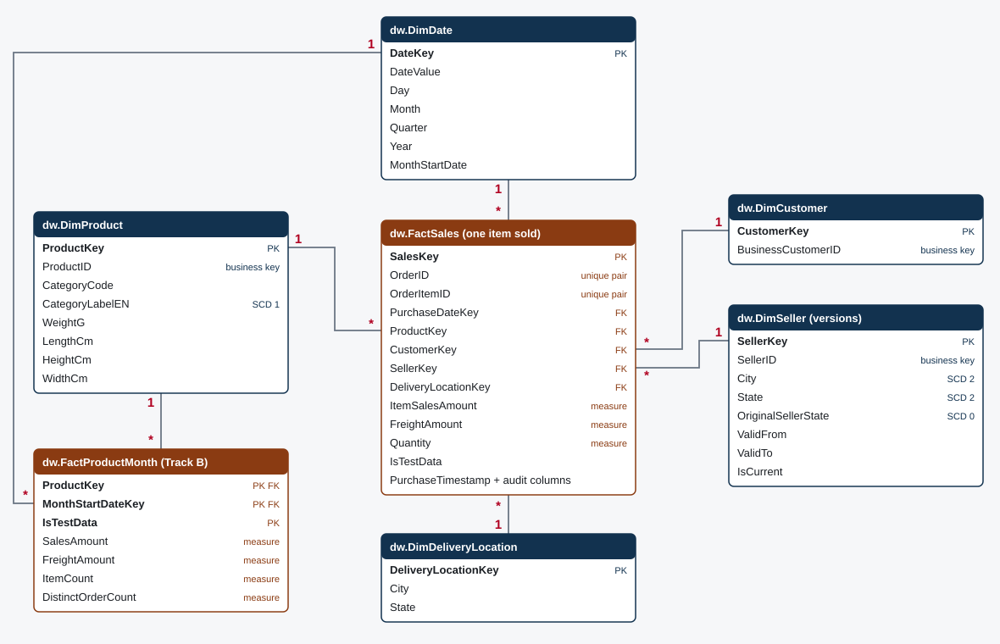

# Olist Data Warehouse — Products and Categories (Track B)


A data warehouse for the Olist online marketplace, built in SQL Server for a Business Intelligence course.
It loads the raw CSV files, cleans them, keeps history, processes new batches safely and answers
product and category questions.

**[Project report (PDF)](docs/Olist_DW_Track_B_Report.pdf)** ·
**[Design document](docs/design.md)** ·
**[Data dictionary](docs/data_dictionary.md)** ·
**[Batch manifest](docs/batch_manifest.md)**

## Contents

[Highlights](#highlights) · [Architecture](#architecture) · [Data model](#data-model) ·
[Quick start](#quick-start) · [Batches](#batches) · [Findings](#findings-real-data) ·
[Quality checks](#quality-checks) · [Repository layout](#repository-layout) ·
[Data source](#data-source) · [Team](#team)

## Highlights

- **Star schema:** `FactSales` and five dimensions, plus `FactProductMonth` for Track B.
- **Snowflake alternative:** category stored in its own table; results equal the star.
- **History:** Slowly Changing Dimensions Type 0, Type 1 and Type 2.
- **Incremental loads:** three batches and a track update test, including a late order and a correction.
- **Safe reruns:** each batch is one transaction; a failed batch rolls back; a replay changes 0 rows.
- **Reconciled:** 109,880 real sales rows and 13,181,027.13 BRL match the source files.
- **OLAP:** roll-up, drill-down, slice, dice and pivot.

## Architecture



| Schema | Role |
|---|---|
| `src` | Unchanged copy of the CSV files |
| `lab` | Fictional test records, kept as ordered changes |
| `stg` | Records of each batch, validated before loading |
| `dw` | Dimensions and facts |
| `sf` | Snowflake alternative |
| `mart` | Reporting views |
| `etl` | Batch list, load log, data issues, load procedures |

All loads start manually with one procedure: `EXEC etl.usp_RunBatch @BatchID = 1;`

## Data model



| Fact table | One row is |
|---|---|
| `dw.FactSales` | one item of a delivered order |
| `dw.FactProductMonth` | one product, one purchase month, one `IsTestData` value |

| Reporting view | Content |
|---|---|
| `mart.vwCategoryMonth` | sales, freight, items and distinct orders per category and month |
| `mart.vwProductRanking` | product sales, share and rank inside the category per month |

The snowflake diagram is in [docs/diagrams/snowflake_schema.svg](docs/diagrams/snowflake_schema.svg).

## Quick start

### Requirements

- SQL Server and `sqlcmd` or SSMS, with Windows authentication.
  The scripts were run with `sqlcmd` on SQL Server 2022 Express.
- At least about 1 GB of free memory. With about 300 MB, SQL Server waits for memory
  (`RESOURCE_SEMAPHORE`) and the load stops moving.

### Steps

1. Download the [dataset](https://www.kaggle.com/datasets/olistbr/brazilian-ecommerce)
   and put the CSV files in a folder named `Data` in the project root.
2. Set `@DataPath` in [sql/02_source_import.sql](sql/02_source_import.sql) to that folder.
3. Run all scripts from PowerShell in the project root:

```powershell
powershell -ExecutionPolicy Bypass -File .\run_all.ps1 -Reset
```

> **Warning:** `-Reset` deletes the database `OlistDW_Project` and builds it again.
> The CSV files are not changed.

Add `-Server .\SQLEXPRESS` to use another instance. Each output is saved in `results/`.

### Run order (manual, SSMS)

If SSMS shows a certificate error, select **Trust server certificate**.

| Step | Script | Purpose |
|---|---|---|
| 0 | `sql/00_reset.sql` | Reset only: **deletes** `OlistDW_Project` |
| 1 | `sql/01_database_schemas.sql` | Database and schemas |
| 2 | `sql/02_source_import.sql` | Import CSV files into `src` |
| 3 | `sql/03_staging_etl_tables.sql` | `stg`, `lab` and `etl` tables |
| 4 | `sql/04_prepare_batches.sql` | Batches B1–B3 and test records |
| 5 | `sql/05_dw_sf_tables.sql` | Star, track table, snowflake, calendar |
| 6 | `sql/06` … `sql/11` | ETL procedures, in number order |
| 7 | `sql/12_mart_views.sql` | Reporting views |
| 8 | `tests/T1_check_batch.sql` | Test check procedure |
| 9 | `sql/13_run_B1.sql` | Initial full load |
| 10 | `sql/14_run_B2.sql` | Incremental load, SCD, failure and retry, replay |
| 11 | `sql/15_run_B3_replay.sql` | Late order, correction, replay |
| 12 | `tests/T2` … `tests/T5` | Reconciliation, SCD, integrity, data quality |
| 13 | `sql/19_snowflake_compare.sql` | Star versus snowflake |
| 14 | `sql/18_olap.sql` | OLAP operations |
| 15 | `sql/16_run_X1.sql` | Track B update test and replay |
| 16 | `sql/17_track_b_queries.sql` | Three business queries |
| 17 | `sql/20_batch_manifest.sql` | Batch manifest |

Run the load scripts (13–16) **once each after a reset**. Script 14 tests a failed B2 load,
so it stops with an error if B2 is already loaded.

## Batches

| Batch | Order purchase dates | Real sales rows | Test changes |
|---|---|---|---|
| B1 | 2017-01-01 to 2017-12-31 | 49,556 | initial test records |
| B2 | 2018-01-01 to 2018-06-30 | 46,219 | SCD Type 0, 1 and 2 changes |
| B3 | 2018-07-01 to 2018-08-31 | 14,105 | late 2017 order and a price correction |
| X1 | — | — | late December 2017 order (Track B update test) |

## Findings (real data)

Delivered orders only. Sales are item prices in BRL; they exclude freight and are not profit.

| Question | Result |
|---|---|
| Which categories contribute most to monthly sales? | `health_beauty` 9.33%, `watches_gifts` 8.83%, `bed_bath_table` 7.76%, `sports_leisure` 7.23%, `computers_accessories` 6.74% of all sales |
| Which products have the largest share inside their category? | In the three largest categories the leading product holds only 3.22% to 5.17% |
| Which categories gained or lost sales (Jan–Aug 2018 against Jan–Aug 2017)? | Total +141.1%; 57 gained, 14 lost, 3 had no 2017 base |

Limits: August 2018 can be incomplete, large percentages often come from a small 2017 base, and there is
no cost data. Details are in the [report](docs/report.md).

## Quality checks

| Check | What it proves | Output |
|---|---|---|
| T1 | Test records give the expected results after every batch | [13](results/13_run_B1.txt), [14](results/14_run_B2.txt), [15](results/15_run_B3_replay.txt), [16](results/16_run_X1.txt) |
| T2 | Warehouse totals equal the source totals | [output](results/T2_reconciliation.txt) |
| T3 | One current seller row, no overlapping periods, correct versions | [output](results/T3_scd_checks.txt) |
| T4 | No orphan rows and no duplicate rows | [output](results/T4_integrity.txt) |
| T5 | Bad rows are rejected, then rolled back | [output](results/T5_negative_dq.txt) |
| Snowflake | Star and snowflake give the same category sales | [output](results/19_snowflake_compare.txt) |

All checks passed in the last full run.

**Test data:** records that start with `LAB_` are fictional. They have `IsTestData = 1` and exist only to
test the loads. Business reports use `IsTestData = 0`. The seller relocation is simulated.

## Repository layout

```text
.
├── sql/          numbered scripts: setup, ETL, loads, views, queries
├── tests/        checks T1 to T5
├── docs/         report, design, data dictionary, batch manifest, diagrams
├── results/      output of every script from the last full run
├── run_all.ps1   runs everything in order
└── Data/         raw CSV files (not committed)
```

`docs/database_guide.html` is an Arabic guide to all tables. Download it and open it in a web browser.

## Data source

[Brazilian E-Commerce Public Dataset by Olist](https://www.kaggle.com/datasets/olistbr/brazilian-ecommerce),
license **CC BY-NC-SA 4.0**. Credit: Olist.

- Download date: 27 November 2026
- Dataset version: not recorded
- Raw CSV files are not committed. Do not edit them.
- The geolocation file is optional and is not used.

<details>
<summary>Import settings and file checksums (SHA-256)</summary>

| Setting | Value |
|---|---|
| Method | `BULK INSERT` into text columns, first row skipped |
| Format | `FORMAT = 'CSV'`, field quote `"`, separator `,` |
| Encoding | UTF-8 (`CODEPAGE = '65001'`) |
| Row end | `0x0d0a` for reviews and category translation, `0x0a` for the others |

| File | SHA-256 |
|---|---|
| olist_customers_dataset.csv | `983a422239e1712ded753b3bf9ecf47dc73f144d306029dcfa99e70a226883d2` |
| olist_order_items_dataset.csv | `0bc4d068c4fe38cbb01bd90e8746e3c613fe7b4baef75fab7b0e329701c3e279` |
| olist_order_payments_dataset.csv | `4f713964f2815dbbaa40b9488268c55aac3627bfce5aa96cf58d1f3616de3cc0` |
| olist_order_reviews_dataset.csv | `012b61c7593e34f51fa614efdf802b9c7056ce6aae5307ddb93236e7cfc797d7` |
| olist_orders_dataset.csv | `8df58ef3d2d7e9944010f7beecd9b75367f5588ec6e3c91cec19ae3345ef9ecf` |
| olist_products_dataset.csv | `3e6569628a17fbc75fd206ee357b59e20364b9afa90f5b6cd5b4d624c58aa9cc` |
| olist_sellers_dataset.csv | `1f643d2b950373b85735e7794b20986f528d7a000432e7c6f9bcbb44d0846a0e` |
| product_category_name_translation.csv | `a81f0d1f27b27e7293f761bc79e3ce8f348ee39c4b3ed3e49bde38f478586278` |

</details>

## Team

- Shehap Sherif EL-Batanouny
- Ahmed Hossam
- Abdulmalek Mahmoud
- Rohiam Tamer
