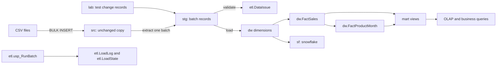
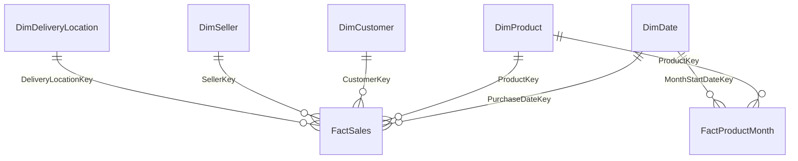
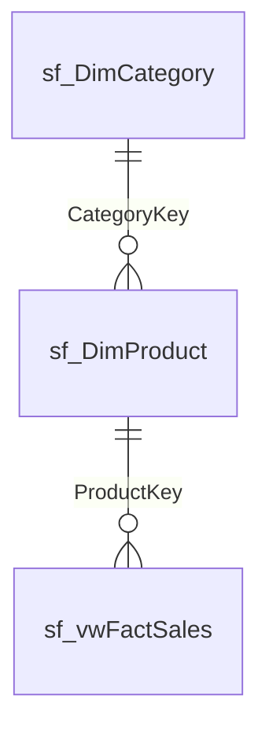

# Design document - Olist Data Warehouse, Track B

## 1. Fundamentals

| Idea | In this project |
|---|---|
| Database | `OlistDW_Project` is one SQL Server database. The warehouse is implemented inside it. |
| Data warehouse | The `dw` schema: data organized for analysis, with history (`DimSeller`) and surrogate keys. |
| OLTP (transaction processing) | The CSV extracts in `src` look like operational tables: `Orders`, `OrderItems`, `Payments`. They are shaped to record single transactions. `src` is a static extract, not a live system. |
| OLAP (analysis) | `dw` and `mart`: few joins from a fact to its dimensions, and queries that summarize many rows (sales by month and category). |

Example: to get category sales by month from `src`, a query joins orders, items, products and translations and converts text to numbers and dates. In `dw` it joins `FactSales` to `DimDate` and `DimProduct`.

## 2. Architecture

| Part | Role |
|---|---|
| `src` | Unchanged copy of the eight CSV files, all text. |
| `lab` | Fictional test records as ordered changes (`BatchID`, `ChangeSeq`). Added so that `src` stays unchanged. |
| `stg` | The records of each batch, with `BatchID`, `ChangeSeq`, `Operation`, `ReceivedAt`. |
| ETL | Stored procedures in `etl`, started manually with `etl.usp_RunBatch`. |
| `dw` | Dimensions and facts. |
| `sf` | Small snowflake alternative. |
| `mart` | Reporting views (logical data marts). |
| `etl` | Batch list, load log, data issues, last successful batch. |

## 3. Star schema

## 4. Snowflake alternative

`sf.DimProduct` **reuses** the `ProductKey` values of `dw.DimProduct`. `sf.vwFactSales` shows the same rows as `dw.FactSales`. The other dimensions are shared.

| Topic | Star | Snowflake |
|---|---|---|
| Joins for category sales | Fact -> `DimProduct` (1) | Fact -> `sf.DimProduct` -> `sf.DimCategory` (2) |
| Category label stored | On every product of the category | Once per category |
| Type 1 label correction | Updates every matching product row | Updates one category row |

Both are updated in the same batch transaction. `sql/19_snowflake_compare.sql` shows that results are equal. No performance claim is made, because speed was not measured.

## 5. Grain, keys and measures

| Fact | Grain (one row is) | Business key | Dimension keys | Measures and valid aggregation |
|---|---|---|---|---|
| `dw.FactSales` | one item of a delivered order | `OrderID`, `OrderItemID` (unique) | date, product, customer, seller version, delivery location | `ItemSalesAmount`, `FreightAmount`, `Quantity` can be summed. Orders = `COUNT(DISTINCT OrderID)`. |
| `dw.FactProductMonth` | one product, one purchase month, one `IsTestData` | same three columns (primary key) | product, month (first day) | `SalesAmount`, `FreightAmount`, `ItemCount` can be summed. `DistinctOrderCount` can be summed across months of one product, **not across products**. |

- Surrogate keys are integers generated by the warehouse. Business keys are kept for matching. `DateKey` is `YYYYMMDD`.
- Key `0` is the unknown member: a descriptive value is missing, but the fact is valid.
- Sales exclude freight and are not profit. Currency is BRL. Average order value = sales / distinct orders.
- Ratios are calculated after aggregation, with `NULLIF` against division by zero.
- Why category orders come from `FactSales`: an order with two products of one category would be counted twice if product counts were added.

## 6. Source-to-target mapping

| Target | Source | Rule |
|---|---|---|
| `DimDate` | generated | 2017-01-01 to 2018-12-31 + unknown |
| `DimProduct.ProductID` | `products.product_id` | one row per product |
| `.CategoryCode` | `products.product_category_name` | empty -> NULL |
| `.CategoryLabelEN` | `translation.product_category_name_english` | no category -> `Unknown`; no translation -> the code |
| `.WeightG, LengthCm, HeightCm, WidthCm` | `products.product_*` | integer, NULL kept |
| `DimCustomer.BusinessCustomerID` | `customers.customer_unique_id` | one row per person |
| `DimDeliveryLocation.City, State` | `customers.customer_city, customer_state` of the order's `customer_id` | trimmed, city lower case, state upper case |
| `DimSeller.SellerID, City, State` | `sellers.*` | versioned |
| `DimSeller.OriginalSellerState` | first loaded state | never changed |
| `FactSales.OrderID, OrderItemID` | `order_items.*` | only if the order status is `delivered` |
| `.ItemSalesAmount` | `order_items.price` | `DECIMAL(18,2)` |
| `.FreightAmount` | `order_items.freight_value` | `DECIMAL(18,2)` |
| `.Quantity` | constant 1 | `order_item_id` is a sequence, not a quantity |
| `.PurchaseDateKey` | `orders.order_purchase_timestamp` | `YYYYMMDD` |
| `.SellerKey` | seller version at purchase time | `ValidFrom <= purchase < ValidTo` |
| `FactProductMonth` | `FactSales` | recompute affected product-months |
| `sf.DimCategory`, `sf.DimProduct` | `dw.DimProduct` | normalized category |

Payments and reviews are imported, staged and validated, but Track B has no fact table for them. Geolocation is not used.

## 7. Slowly changing dimensions

| Type | Attribute | Behaviour |
|---|---|---|
| 0 | `DimSeller.OriginalSellerState` | Kept. An incoming change is logged as `SCD0_IGNORED`. |
| 1 | `DimProduct.CategoryLabelEN` (and other product attributes) | Overwritten. Same `ProductKey`. Old sales show the new label. |
| 2 | `DimSeller.City, State` | Old row expired, new row with new `SellerKey`. |

- `ValidFrom` is inclusive and `ValidTo` is exclusive. The open row ends at 9999-12-31.
- First-load sellers start on 2017-01-01. Later new sellers start at their first purchase in the batch.
- A filtered unique index allows one current row per seller. The load stops if periods overlap.
- Olist has no real relocation history. The initial snapshot is a teaching baseline and the LAB relocation is **simulated**.

## 8. Incremental loading

- A batch contains the real orders of its date range and every LAB order that has a change record, plus the related records.
- A correction to an old order is found through its change record, not through the purchase date.
- `FactSales`: update changed amounts, then insert new source pairs. Existing keys are kept.
- `FactProductMonth`: affected product-months are deleted and recomputed.
- Each batch is one transaction. The last-successful-batch marker moves only on success.
- A successful batch is skipped on replay. `@Force = 1` reprocesses only the last batch and must change nothing.

## 9. Missing and invalid data

| Case | Action |
|---|---|
| Item without an accepted parent order | rejected |
| Price or freight missing, not a number, or negative | rejected (freight 0 is valid) |
| Exact duplicate source key | first copy kept, others logged as `DUPLICATE` |
| Conflicting duplicate source key | all rejected for a decision |
| Missing product, customer, seller or location | fact kept with key 0 |
| Product without category | label `Unknown` |
| Category without translation | label = code, warning logged |
| Review score outside 1-5 | rejected |
| Unusual city text | cleaned only for spaces and case; values are not guessed |

Rejected rows stay in `stg` with `RejectReason` and are copied to `etl.DataIssue`.

## 10. Limitations

- Deleted records and reversed deliveries are outside the scope.
- Recent orders may not be delivered yet when the data ends, so August 2018 can look lower.
- Seller city text contains errors in the source (for example a state written in the city field).
- Seller attributes of real data never change, because the source is a static snapshot.
